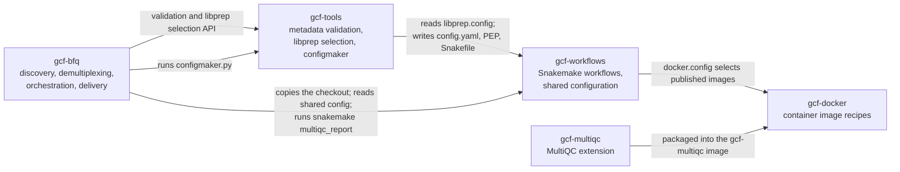

# gcf-workflows

Snakemake workflows used by the Genomics Core Facility (GCF) at NTNU to analyse sequencing projects.
In production, [gcf-bfq](https://github.com/gcfntnu/gcf-bfq) runs them for every demultiplexed project.
For development they can be run standalone, without BFQ.

This repository owns:

- the scientific workflows
- the shared configuration that other GCF repositories read: `libprep.config`, `docker.config` and `demultiplexing.config`
- the reference-data getters in `gcfdb/`
- the MultiQC report configuration in `misc/multiqc/`

## Start here

| Need | Document |
| --- | --- |
| Understand how the GCF repositories depend on each other, and how to change a shared interface | [Suite relationships](docs/suite.md) |
| See which workflows exist and their status | [Workflows](#workflows) |
| Find your way around the source: include order, stages, interim directories, tests | [Architecture](docs/architecture.md) |
| Understand how configuration is merged and paths are resolved | [Configuration](docs/configuration.md) |
| Know what BFQ does with this repository | [How a workflow runs under BFQ](#how-a-workflow-runs-under-bfq) |
| Run a workflow without BFQ | [Running standalone](#running-standalone) |
| Find the report and delivered files | [Outputs](#outputs) |
| Find reference data and change its location | [Reference data](#reference-data), [gcfdb/README.md](gcfdb/README.md) |
| Understand the MultiQC report configuration and provenance | [misc/multiqc/README.md](misc/multiqc/README.md) |
| 10x and QIAseq demultiplexing contracts | [docs/tenx-demultiplexing.md](docs/tenx-demultiplexing.md), [docs/qiaseq-demultiplexing.md](docs/qiaseq-demultiplexing.md) |
| Take an issue to a PR, and coordinate with companion repositories | [CONTRIBUTING.md](CONTRIBUTING.md) |
| Prepare environments and run the checks | [Development guide](docs/development.md) |
| Work as a coding agent | [AGENTS.md](AGENTS.md) |

## The GCF suite



| Repository | Role |
| --- | --- |
| [gcf-bfq](https://github.com/gcfntnu/gcf-bfq) | Long-running pipeline service. Finds finished runs, demultiplexes, runs these workflows per project, and archives and delivers the results. |
| [gcf-tools](https://github.com/gcfntnu/gcf-tools) | Shared metadata validation, library-prep selection and `configmaker.py`, which creates a project's `config.yaml`, PEP and `Snakefile`. |
| gcf-workflows (this repository) | Scientific workflows, shared configuration, reference getters and report configuration. |
| [gcf-docker](https://github.com/gcfntnu/gcf-docker) | Recipes for the container images that workflow rules and BFQ tools run in. |
| [gcf-multiqc](https://github.com/gcfntnu/gcf-multiqc) | GCF modules and hooks for upstream MultiQC, packaged as the `gcf-multiqc` image. |

[docs/suite.md](docs/suite.md) lists every interface between these repositories, who consumes it and how it is checked, and gives recipes for changes that span repositories.

## Workflows

| Workflow | Status | Entry point | Main rule groups (`rules/*.smk`) | More documentation |
| --- | --- | --- | --- | --- |
| `rnaseq` | Active | `rnaseq/rnaseq.smk` | filter, assembly, align, quant, analysis, qc, bfq | [rnaseq/README.md](rnaseq/README.md) |
| `singlecell` | Active | `singlecell/singlecell.smk` | immune, gcfdb, filter, quant, qc, bfq, analysis | [singlecell/README.md](singlecell/README.md), [singlecell/docs](singlecell/docs) |
| `smallrna` | Active | `smallrna/smallrna.smk` | gcfdb, filter, align, quant, qc, bfq | [smallrna/README.md](smallrna/README.md) |
| `metagenome` | Active | `metagenome/metagenome.smk` | reference_db, filter, quant, bfq | [metagenome/README.md](metagenome/README.md) |
| `wgs` | Active | `wgs/wgs.smk` | gcfdb, filter, align, qc, bfq | [wgs/README.md](wgs/README.md) |
| `default` | Active | `default/default.smk` | bfq (shared FASTQ QC) | [default/README.md](default/README.md) |
| `microbiome` | Unmaintained | `microbiome/microbiome.smk` | reference_db, filter, qc, quant, analysis, bfq | [microbiome/README.md](microbiome/README.md) |
| `sars-cov2` | Unmaintained | `sars-cov2/sars-cov2.sm` | Vendored external pipelines | [sars-cov2/README.md](sars-cov2/README.md) |

**Status.** *Active* workflows are maintained and covered by CI dry runs. *Unmaintained* workflows are kept but may not run.
Maintenance status does not mean every kit, route or output of a workflow has been scientifically validated.

**`default`.** This is the workflow for library-prep kits that have no dedicated workflow.
Those kits have an entry in [libprep.config](libprep.config) with `workflow: default`, for example `Custom`.
It runs the shared FASTQ quality control and reporting.
Unknown kits are rejected during library-prep selection; they are never routed to `default` automatically.

Every entry in `libprep.config` names its workflow explicitly.
The selected kit entry decides which workflow a project runs.

## How a workflow runs under BFQ

This is how BFQ uses this repository, as implemented in gcf-bfq (`bcl2fastq_pipeline/afterFastq.py`).
The BFQ production image contains a checkout of this repository at `/opt/gcf-workflows`.

1. **Capture library-prep configuration.** BFQ reads `/opt/gcf-workflows/libprep.config` once per processing attempt.
   It selects the kit entry through the gcf-tools selection API, using the kit and the effective read geometry.
2. **Create the project workdir.** BFQ copies the installed checkout to `<workdir>/src/gcf-workflows`. The copy includes the checkout's Git metadata, which report provenance needs.
   It then overwrites `libprep.config` there with the exact bytes it captured.
3. **Initialize the project.** BFQ runs `configmaker.py` in the workdir.
   It passes the captured configuration, its SHA-256, the selected entry and the expected read geometry, so configmaker can verify them.
   configmaker writes `config.yaml`, `pep/`, `Snakefile` and FASTQ links under `data/raw/fastq/`.
4. **Run the workflow.** BFQ runs `snakemake --use-singularity … multiqc_report` in the workdir.
5. **Copy the products** listed in [Outputs](#outputs), then archive and deliver them.

Two separate BFQ mechanisms involve the project workdir after a run:

- **Provenance snapshot.** After successful finalization, BFQ writes an archive of the workdir without its top-level `data/`, including `src/gcf-workflows`.
  It is a record of what ran. BFQ does not restore or execute it, and it cannot be resumed on its own.
  See [retained analysis workdir snapshots](https://github.com/gcfntnu/gcf-bfq#retained-analysis-workdir-snapshots).
- **Resume.** `fm rerun --from analysis --resume` reuses the existing workdir that BFQ recorded and owns, including its `data/` and Snakemake state.
  It checks the workdir's ownership marker, configuration and FASTQ links, and rejects missing workdirs.
  The resumed run uses the workflow copy in that workdir's `src/gcf-workflows`, not the currently installed checkout.
  See gcf-bfq [analysis resume](https://github.com/gcfntnu/gcf-bfq/blob/bfq-dev/docs/analysis-resume.md).

## Running standalone

Use this to reproduce or develop a workflow outside BFQ.
The example uses the synthetic paired-end fixture published in gcf-tools (`tests/fixtures/paired/`) and runs the `rnaseq` workflow.
It contains no facility data.

**Requirements:**

- Python 3.11
- Snakemake 9.7.1 (the supported version; CI still pins 8.1.1 until [#237](https://github.com/gcfntnu/gcf-workflows/issues/237) lands)
- `pandas`, `peppy`, `rich`
- [gcf-tools](https://github.com/gcfntnu/gcf-tools), which provides `configmaker.py`
- `git`

```bash
python3.11 -m venv .venv
.venv/bin/pip install 'snakemake==9.7.1' pandas peppy rich /path/to/gcf-tools
```

Work in a new, empty project directory.
Put an explicit gcf-workflows checkout with its Git metadata at `src/gcf-workflows` **before** running configmaker:

```bash
mkdir -p project/src input
cp -r /path/to/gcf-tools/tests/fixtures/paired/990101_SYNTHETIC_0001_ASYNTHETIC input/
cd project
git clone https://github.com/gcfntnu/gcf-workflows.git src/gcf-workflows
git -C src/gcf-workflows checkout <revision>
```

If `src/gcf-workflows` is missing, configmaker clones the default branch itself, without pinning a revision.
The report records the workflow branch and commit by reading the checkout's Git metadata.
A copied tree without `.git` does not work for reporting ([misc/multiqc/README.md](misc/multiqc/README.md)).

Create the project configuration, choosing a kit that `libprep.config` routes to `rnaseq`:

```bash
../.venv/bin/configmaker.py ../input/990101_SYNTHETIC_0001_ASYNTHETIC \
  --project-id GCF-2099-001 --libkit "Illumina Stranded mRNA Prep"
```

configmaker validates the SampleSheet and the submission form.
It selects the `Illumina Stranded mRNA Prep PE` entry from the fixture's paired read geometry, and writes:

- `config.yaml`
- `pep/pep_config.yaml` and `pep/sample_table.csv`
- a `Snakefile` that includes `src/gcf-workflows/rnaseq/rnaseq.smk`
- FASTQ links under `data/raw/fastq/`
- `configmaker.analysis-summary.json`

Dry-run the reporting target:

```bash
../.venv/bin/snakemake -n -p --cores 1 multiqc_report
```

**Tested:** Python 3.11.6, Snakemake 9.7.1, gcf-tools 0.4.0 at `26888cc`, gcf-workflows `6175d6e`.
The dry run planned 90 jobs, ending with `data/tmp/rnaseq/bfq/multiqc_GCF-2099-001.html`.

A dry run only shows that Snakemake can build the workflow's job graph (DAG).
It does not download references, run tools or render the report, and it says nothing about scientific correctness.
An actual run additionally needs reference data under the [reference root](#reference-data) (getters download it on demand) and container execution (`--use-singularity`).

To change where files go, use the project settings `ext_dir`, `interim_dir` and `fastq_dir`, or the `GCF_EXT`, `GCF_INTERIM` and `GCF_FASTQ` environment variables.
A nonempty project setting wins over the environment variable.

## Outputs

`multiqc_report` is the Snakemake **target** that BFQ requests.
It produces the project report **file** `data/tmp/<workflow>/bfq/multiqc_<project>.html`.
Its inputs are `BFQ_ALL`, the workflow's delivery products, which the `bfq_all` target also collects.

`data/tmp/<workflow>/bfq/` (`BFQ_INTERIM` in the code) is the delivery staging directory.
Everything BFQ delivers from an analysis comes from there, plus the project sample table:

| Workdir source | Delivered by BFQ as |
| --- | --- |
| `data/tmp/<workflow>/bfq/` | `QC_<project>/bfq/`, which BFQ also archives |
| `data/tmp/<workflow>/bfq/multiqc_<project>.html` | `multiqc_<project>_<run-date>.html` |
| `data/tmp/<workflow>/bfq/.multiqc_config.yaml` | `.multiqc_config_<project>.yaml` |
| `data/tmp/<workflow>/bfq/summaries/all_samples*.html` (single-cell) | `all_samples_web_summary_<project>_<run-date>.html` |
| `data/tmp/sample_info.tsv` | `<project>_samplesheet.tsv` |

Other files under `data/tmp/` are intermediate and not delivered.
What each workflow places in `bfq/` is listed in its README, linked from the [workflow table](#workflows).

## Configuration

A project run combines:

- **Project configuration:** `config.yaml` and the PEP in `pep/`, generated by configmaker from the SampleSheet, the submission form and the selected kit.
- **Shared defaults in this repository:**
  - [main.config](main.config): reference-database (`gcfdb`) configuration and common defaults shared across workflows, including each workflow's MultiQC module list
  - [libprep.config](libprep.config): kit entries, read layout and workflow routing
  - each workflow's `<workflow>.config`: defaults specific to that workflow
  - [docker.config](docker.config): container images
- **Optional site secrets:** a YAML file named by the `GCF_SECRET` environment variable, read by [utils.py](utils.py). Its contents never belong in this repository.

These sources are not combined by simple overriding: some merges fill only missing keys, others overwrite.
Project values win; a workflow's own `<workflow>.config` has the lowest priority; and `GCF_SECRET` is not an unconditional override.
[docs/configuration.md](docs/configuration.md) documents the exact order, with a synthetic example, and how paths are resolved.
[demultiplexing.config](demultiplexing.config) is read by BFQ for 10x conversion profiles, not by the workflows ([docs/tenx-demultiplexing.md](docs/tenx-demultiplexing.md)).

## Reference data

Reference getters in [gcfdb/](gcfdb/) download and build databases, genomes and annotations under one reference root, `EXT_DIR`:

1. a nonempty project `ext_dir`, otherwise
2. the `GCF_EXT` environment variable, otherwise
3. `data/ext` in the working directory.

Getters and rules must not hardcode another root. `gcfdb/.tests/test_reference_roots.py` checks this.
Releases and assemblies are selected in `main.config` and the project configuration.
[gcfdb/README.md](gcfdb/README.md) describes resource identity and how to override reduced test resources.

## Branches, versions and production

- **`bfq-dev`** is the development and integration branch. Start issue branches from it and target it with PRs.
- **`main`** is the production branch. BFQ production images are built with gcf-workflows from `main`, together with gcf-bfq and gcf-tools from `master`.
- **Promotion is a separate step.** Merging to `bfq-dev` does not update production. Promoting to `main`, building an image and deploying it are separate, deliberate steps owned by the BFQ release process.
- **Reports record the workflow version.** Each project report records the workflow branch and full commit ID under *Analysis pipeline*. That commit is the analysis version of the deliverable.

## Development and testing

Local checks need no facility data, containers or reference downloads. They are Snakemake dry runs and unit tests on synthetic fixtures:

- `bash test-all.sh` dry-runs `multiqc_report` in the seven CI workflow fixtures, and exits nonzero and names the failures if any fails.
- Focused `unittest` and `pytest` suites cover the reporting configuration, reference roots, metagenome references, WGS delivery, single-cell, small-RNA AnnData and QIAseq demultiplexing.
- CI (`.github/workflows/`) runs them on every push and pull request. Most jobs still pin Snakemake 8.1.1; the move to 9.7.1 is tracked in [#237](https://github.com/gcfntnu/gcf-workflows/issues/237).

The [development guide](docs/development.md) has the environments, the exact commands, the CI job matrix and what the checks do and do not prove.
[CONTRIBUTING.md](CONTRIBUTING.md) describes how to take an issue to a PR.

Test fixtures are synthetic.
Follow the public-content rules in [AGENTS.md](AGENTS.md): no real project, sample or run identifiers, and no facility infrastructure details, anywhere in this repository or its issues and PRs.

## Credits and licence

Developed by the Genomics Core Facility, Norwegian University of Science and Technology (NTNU).
BSD 2-Clause licence; see [LICENSE](LICENSE).
Vendored third-party pipelines under `sars-cov2/external_pipelines/` keep their own licences.
