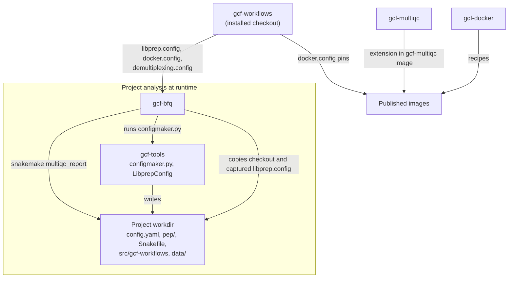

# GCF suite relationships

This page describes how gcf-workflows relates to the other public GCF repositories:

- what each repository owns
- which gcf-workflows files and conventions other repositories read
- how compatibility is checked
- how to make changes that span more than one repository

The [README](../README.md) gives the overview and the BFQ runtime sequence.

Facts were checked against these revisions; recheck them when an interface changes:

| Repository | Revision |
| --- | --- |
| gcf-workflows `bfq-dev` | `6175d6e` |
| [gcf-bfq](https://github.com/gcfntnu/gcf-bfq) `bfq-dev` | `d171c72` |
| [gcf-tools](https://github.com/gcfntnu/gcf-tools) `bfq-dev` | `26888cc` |
| [gcf-docker](https://github.com/gcfntnu/gcf-docker) `master` | `5c25322` |
| [gcf-multiqc](https://github.com/gcfntnu/gcf-multiqc) `main` | `8953491` |

## Ownership

| Repository | Owns | Does not |
| --- | --- | --- |
| [gcf-bfq](https://github.com/gcfntnu/gcf-bfq) | Run discovery, flowcell state and recovery, demultiplexing, the analysis invocation, report copying, archives, delivery, notifications | Reimplement metadata or library-prep rules; install the MultiQC engine in its own Python environment; contain scientific workflow logic |
| [gcf-tools](https://github.com/gcfntnu/gcf-tools) | SampleSheet and submission-form validation, `configmaker.py`, the `LibprepConfig` selection API, organism descriptors | Execute workflows; own kit definitions |
| gcf-workflows | Scientific workflows; `libprep.config`, `docker.config`, `demultiplexing.config`; reference getters (`gcfdb/`); MultiQC report configuration (`misc/multiqc/`) | Orchestrate runs or deliver data |
| [gcf-docker](https://github.com/gcfntnu/gcf-docker) | Image recipes and their publication | Decide which image a workflow uses (that is `docker.config`) |
| [gcf-multiqc](https://github.com/gcfntnu/gcf-multiqc) | GCF modules and hooks for unmodified upstream MultiQC | Select modules for a report (that is `main.config` `multiqc:` and `misc/multiqc/`) |

Coordinate interface changes explicitly.
A change in one repository that alters what another repository reads needs linked issues or PRs in both.

## Interfaces provided by gcf-workflows

| Interface | Consumers and how they read it | Source | Compatibility check |
| --- | --- | --- | --- |
| **`libprep.config`** | **gcf-bfq:** `workflow_config.capture_config` reads `/opt/gcf-workflows/libprep.config` once per attempt, selects the entry through gcf-tools, and writes the captured bytes into the workdir copy. **gcf-tools:** `LibprepConfig.select(kit, read_geometry)`. configmaker verifies BFQ's `--libprep-config`, `--libprep-sha256`, `--libprep-entry` and `--expected-read-geometry`. **gcf-workflows at run time:** `utils.py` merges the `<kit> PE`/`<kit> SE` entry into the configuration. **Rules that read it directly:** metagenome and microbiome cutadapt, microbiome QIIME2, `gcfdb/qiime2_classifiers.smk`. | [libprep.config](../libprep.config); selection semantics in gcf-tools [libprep-config.md](https://github.com/gcfntnu/gcf-tools/blob/bfq-dev/docs/libprep-config.md) | gcf-tools libprep tests; gcf-bfq `tests/test_workflow_config.py`; workflow dry runs |
| **`docker.config`** | **gcf-workflows:** `utils.py` fills missing `config['docker']` keys; image keys set explicitly in a project win. **gcf-bfq:** `containers.py` resolves a fixed tool set (`bcl-convert`, `bcl2fastq`, `cellranger`, `cellranger-atac`, `spaceranger`, their `*-mkfastq` variants, `multiqc`) from `/opt/gcf-workflows/docker.config`, or from the file named by `GCF_WORKFLOWS_DOCKER_CONFIG`. | [docker.config](../docker.config); images from gcf-docker | `misc/multiqc/.tests/test_report_contract.py`; gcf-bfq `tests/test_containers.py` and `scripts/check_install.py` |
| **`demultiplexing.config`** | **gcf-bfq only:** `tenx_demultiplexing.py` requires `schema_version: 1` and records the file's SHA-256. No workflow rule reads it. | [demultiplexing.config](../demultiplexing.config); contract in [tenx-demultiplexing.md](tenx-demultiplexing.md) | `singlecell/.tests/test_demultiplexing_profiles.py` |
| **`multiqc_report` target** | **gcf-bfq:** `afterFastq.snakemake_command` runs `snakemake --use-singularity … multiqc_report` in the project workdir, then copies the [delivered outputs](../README.md#outputs). | `postprocess.smk`; `BFQ_ALL` per workflow | Seven CI dry runs; `test-all.sh` |
| **Project workdir layout** (`config.yaml`, `Snakefile`, `pep/`, `src/gcf-workflows/`, `data/raw/fastq/`, `data/tmp/`) | Created by configmaker. The generated `Snakefile` includes `src/gcf-workflows/<workflow>/<workflow>.smk`. gcf-bfq keeps the workdir without `data/` as an analysis snapshot and reuses it with `fm rerun --from analysis --resume`. | gcf-tools [compatibility.md](https://github.com/gcfntnu/gcf-tools/blob/bfq-dev/docs/compatibility.md); gcf-bfq README | gcf-tools CLI checks; gcf-bfq snapshot and resume tests |
| **Report provenance** | `misc/multiqc/create_mqc_config.py` reads the branch and commit from the Git metadata of `src/gcf-workflows` and writes them into the report. | [misc/multiqc/README.md](../misc/multiqc/README.md) | `misc/multiqc/.tests` |
| **Reference root** | Every getter and rule resolves reference data under `EXT_DIR`: project `ext_dir`, then `GCF_EXT`, then `data/ext`. | `utils.py`, [gcfdb/README.md](../gcfdb/README.md) | `gcfdb/.tests/test_reference_roots.py` |

## Distinctions that matter

- **Standalone configmaker vs BFQ.**
  - Standalone, configmaker selects from `src/gcf-workflows/libprep.config`. If `src/gcf-workflows` is missing, it clones the default branch of gcf-workflows, unpinned.
  - Under BFQ, the configuration is the snapshot captured from the installed checkout. configmaker only verifies it against the hash, entry and read geometry BFQ passes in.
- **Retained workdir vs installed checkout.** A retained or resumed analysis uses the workflow copy in its own `src/gcf-workflows`. Installing a new gcf-workflows revision does not change it.
- **Project image keys vs shipped mapping.**
  - Workflow rules take an image key from the project configuration if it is set there, and from `docker.config` otherwise.
  - BFQ's own tool wrappers read only the installed `docker.config`, or the file named by `GCF_WORKFLOWS_DOCKER_CONFIG`.
- **Kit routing.**
  - Every `libprep.config` entry names its workflow.
  - Unknown kits fail selection.
  - `default` is used only for entries that set `workflow: default`, for example `Custom`.
- **Merge vs production.** Merging to `bfq-dev` is development integration. Production uses gcf-workflows `main`, built into a BFQ image and deployed in separate, deliberate steps.

## Recipes for cross-repository changes

Each recipe lists:

- the repositories to touch, in order
- the checks to run
- what is deliberately not part of the change

Use issue branches from `bfq-dev` in each repository. Link the PRs to each other.

### Add or modify a library-prep kit

1. **gcf-workflows.**
   - Add or edit the entry in `libprep.config`. Use `<kit> PE` and/or `<kit> SE` names, or one unsuffixed name with a layout.
   - Set `workflow:` to an existing workflow, or to `default` when no dedicated workflow applies.
   - Add kit-specific parameters, such as `filter.trim` or adapters, under the entry.
   - Selection rules (name matching, suffixes, read geometry) are defined in gcf-tools [libprep-config.md](https://github.com/gcfntnu/gcf-tools/blob/bfq-dev/docs/libprep-config.md). Follow them; do not restate them here.
2. **gcf-tools.** Needed only when the kit introduces new metadata validation, a new selection rule or a new entry field that selection must understand.
3. **gcf-bfq.** Needed only when the orchestration contract changes, for example a new sample-sheet custom option. A new kit entry alone needs no BFQ change: BFQ reads `libprep.config` from the installed checkout.
4. **Check:**
   - `libprep.config` still loads and selects in gcf-tools (`LibprepConfig.load(...).select(kit, geometry)`)
   - a dry run of the routed workflow succeeds with a fixture that uses the kit
   - `bash test-all.sh` passes

The kit reaches production when gcf-workflows `main` is promoted and a BFQ image is rebuilt.

### Add or update a tool image

1. **gcf-docker.** Add or change the recipe and publish the image, following gcf-docker. This recipe stops at the published image reference.
2. **gcf-workflows.**
   - Set the image in `docker.config` under the key the rules use: `container: 'docker://' + config['docker']['<key>']`.
   - Pin by digest where that is established practice, as for `multiqc`. Otherwise use an explicit version tag.
3. **gcf-bfq.** Needed only for tools BFQ itself runs (the `containers.py` tool set). It reads the new mapping from the installed checkout; check the gcf-bfq install verification.
4. **Check:**
   - dry runs of the workflows that use the key
   - `misc/multiqc/.tests` if the key is `multiqc`

Running the tool in the container is an integration step outside these checks.

### Add or change a MultiQC module

1. **gcf-multiqc.** Implement or change the module or hook. Modules register through the `multiqc.modules.v1` entry points, hooks through `multiqc.hooks.v1`.
2. **gcf-docker.** Rebuild and publish the `gcf-multiqc` image, following gcf-docker.
3. **gcf-workflows.**
   - Pin the new image digest under `multiqc` in `docker.config`.
   - Add the module to `multiqc.<workflow>.modules` in `main.config`. `postprocess.smk` passes that list to MultiQC as `-m` options.
   - Adjust the report settings in `misc/multiqc/multiqc_config-<workflow>.yaml` if needed.
   - Make sure the workflow places the module's input files under `data/tmp/<workflow>/bfq/`.
4. **gcf-bfq.** Its sequencing report uses the same `multiqc` key through the installed `docker.config`. Coordinate when a module used by BFQ changes; see gcf-bfq `docs/multiqc-adoption.md`.
5. **Check:**
   - `misc/multiqc/.tests`
   - dry runs of the affected workflows

Report rendering and content comparison are integration steps outside these checks.

### Add a reference database

1. **gcf-workflows.**
   - Add a getter `gcfdb/<name>.db`. Its outputs go under `EXT_DIR`, as `join(EXT_DIR, '<name>', '{release}', ...)`.
   - Never assign `EXT_DIR` or hardcode an absolute root.
   - Add the default release to `main.config` under `db:`.
   - Include the getter from the workflow or the selection logic that needs it.
2. **Check:**
   - a dry-run test that resolves the getter's outputs without downloading, following `gcfdb/.tests/test_reference_roots.py` or `metagenome/.tests/test_bracken_database.py`
   - `gcfdb/.tests` (the guard against hardcoded roots)
   - dry runs of the affected workflows
3. Document the database's identity and any reduced test variant in [gcfdb/README.md](../gcfdb/README.md).

### Add a workflow

1. **gcf-workflows.**
   - Create `<workflow>/<workflow>.smk`. Follow the include convention of existing entry points: `../utils.py`, the workflow config, `../common.smk`, the stage rules, `../postprocess.smk`.
   - Populate `BFQ_ALL`, provide a `bfq_all` rule, add `misc/multiqc/multiqc_config-<workflow>.yaml` and a `multiqc.<workflow>.modules` entry in `main.config`, so that `multiqc_report` works.
   - Add synthetic fixtures in `<workflow>/.tests`, a CI job, and the workflow to `test-all.sh`.
   - Route at least one kit to it in `libprep.config`.
2. **gcf-tools.** configmaker writes the `Snakefile` include `src/gcf-workflows/<workflow>/<workflow>.smk` from the selected entry. Check that the workflow name is valid for selection.
3. **gcf-bfq.** BFQ copies `data/tmp/<workflow>/bfq/` generically. Coordinate only if the workflow needs delivery behaviour beyond the [shared outputs](../README.md#outputs).
4. **Check:**
   - the new workflow's dry run
   - `bash test-all.sh`
   - a configmaker initialization with a synthetic fixture routed to it, as in the [standalone recipe](../README.md#running-standalone)

## Promotion and deployment

A merged change is not deployed. For gcf-workflows, production promotion means merging `bfq-dev` into `main`.
A new BFQ image built from gcf-bfq `master`, gcf-tools `master` and gcf-workflows `main` is what carries the change to production.
Building and deploying that image belongs to the BFQ release process; see the gcf-bfq README.
